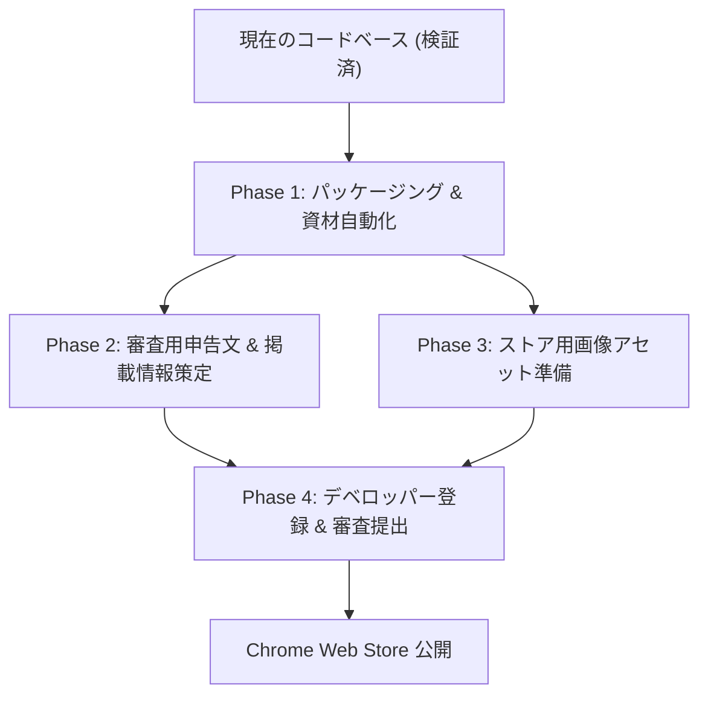

# Chrome Web Store リリース計画書 (ImageCrate)

ImageCrate を Chrome Web Store (CWS) で一般リリースするために必要な対応項目の洗い出しと実行計画です。
ユーザー方針「機能は完璧である必要はなく、最低限のセキュリティ対応とクラッシュしない程度のバグ対応」に基づき、過剰な改修を行わず、**審査通過と安全な公開に必要な最短ルート**を定めています。

---

## 1. 現状の技術・セキュリティ健全性評価

現状のコードベースは、要件である「最低限のセキュリティ対応とクラッシュしない程度のバグ対応」を**既に大幅に上回る高水準**で満たしています。

| 評価観点 | 現状の実装・対策 | 検証結果 |
|---|---|---|
| **セキュリティ (CSP / 外部送信)** | ・Manifest V3 準拠<br>・厳格な CSP (`script-src 'self'; img-src 'self' blob:; ...`)<br>・外部スクリプト・外部ライブラリ依存ゼロ<br>・`eval` / インラインスクリプトの完全排除<br>・外部通信・テレメトリ・解析送信ゼロ（完全ローカル処理） | `npm run test:security`<br>**18項目 全件 PASS** |
| **クラッシュ・安定性対策** | ・1スキャン最大500候補 / 12,000要素の境界制御<br>・25ms チャンク処理によるメインスレッド凍結防止<br>・転送バジェット・30秒無進捗検知・最大3回試行リミット<br>・Service Worker 停止/再起動に耐える `alarms` 復元設計<br>・ダウンロード/フォルダピッカー キャンセル時の安全処理 | `npm test`<br>**351項目 PASS**<br>`npm run test:ux`<br>**29項目 PASS** |
| **プラットフォーム互換性** | ・Chrome 116+ 動作保証<br>・`chrome.downloads` リスナーのオプショナルチェーン保護 | `npm run check`<br>**全構文・参照 OK** |

> [!NOTE]
> **結論**: コード修正や機能追加、リファクタリングは不要です。リリースに向けた主作業は「**ストア審査を確実にパスするための申請資材（権限正当化・掲載文・画像・ZIP）の整備**」となります。

---

## 2. リリースに必要な全対応項目



### 対応項目チェックリスト

| カテゴリ | 項目 | 担当/手段 | 優先度 | 状態 |
|---|---|---|---|---|
| **技術・配布** | ストア配布用クリーン ZIP の作成スクリプト (`scripts/package.mjs`) | 自動化 | **必須** | 未着手 (作成可) |
| **審査対策** | `host_permissions` の正当化理由（Permissions Justification）作成 | ドキュメント | **必須 (最難関)** | 本書に文面案策定 |
| **審査対策** | API権限 (`activeTab`, `downloads`, `storage`, `alarms`) の正当化文 | ドキュメント | **必須** | 本書に文面案策定 |
| **審査対策** | プライバシーポリシーの公開URL確保 (GitHub上の `docs/PRIVACY.md`) | 設定 | **必須** | 既存ファイルあり |
| **審査対策** | 単一目的 (Single Purpose) およびデータ不収集の申告文作成 | ドキュメント | **必須** | 本書に文面案策定 |
| **掲載情報** | 拡張機能のタイトル・概要 (132字以内)・詳細説明文作成 | ドキュメント | **必須** | 本書に文面案策定 |
| **画像アセット** | ストア用アイコン (128x128 PNG) | 既存活用 | **必須** | `extension/icons/icon-128.png` 準備済 |
| **画像アセット** | ストア用スクリーンショット (1280x800 または 640x400、最低1枚) | 生成/撮影 | **必須** | 未準備 (テスト出力等から生成可) |
| **画像アセット** | （推奨）スモールプロモーション画像 (440x280 PNG) | 制作 | 推奨 | 未準備 |
| **アカウント** | Chrome Web Store Developer アカウント登録 ($5 初回登録料 + 2FA) | ユーザー手動 | **必須** | ユーザー側作業 |

---

## 3. Chrome Web Store 審査の最重要関門（リジェクト防止策）

Chrome Web Store で審査落ち（Rejection）する最大の原因は **「広範な権限の正当化不足」** です。
ImageCrate は `host_permissions: ["http://*/*", "https://*/*"]` を保持しているため、ダッシュボードでの適切な申告が合否を分けます。

### なぜ `host_permissions` が必要なのか（審査官への説明ロジック）

1. **用途の必然性**:
   Webページに表示される画像は、ページのドメインとは異なる **外部CDNや別オリジンの画像サーバー（Cloudinary, AWS S3, imgur等）** にホストされているケースが大半です。
2. **`activeTab` の限界**:
   `activeTab` 権限は現在開いているタブのDOM読み取りを許可しますが、クロスオリジン（別ドメイン）の画像バイナリを `fetch()` してプレビュー生成・フォーマット変換（Canvas経由）したり、File System Access API でローカルフォルダに直接書き込む際には、CORSによりブロックされます。
3. **最小特権の担保**:
   閲覧履歴の収集やCookieの読み取り・外部送信は一切行わず、ユーザーが明示的に保存・プレビューを選択した画像のバイナリ取得にのみ使用していることを明記します。

---

## 4. ストア申請用テキスト・申告文案（コピー用）

Chrome Developer Dashboard の各入力項目にそのまま転記できる文面です。

### 4.1 基本情報 (Store Listing)

- **名前 (Name)**: `ImageCrate`
- **概要 (Short Description - 132文字以内)**:
  > Webページの画像を確認して選んで一括保存。外部送信なし・完全ローカル処理で安全にダウンロード。
- **カテゴリ**: `生産性 (Productivity)` または `写真 (Photos)`
- **言語**: `日本語 (Japanese)`
- **詳細な説明 (Detailed Description)**:
  ```text
  ImageCrate は、Webページ上に埋め込まれた画像から必要なものだけを快適に選び出し、一括保存するためのブラウザ拡張機能です。

  【主な特徴】
  ・直感的な一覧確認：ページ内の画像を一覧表示し、拡大プレビューや等倍表示で確認しながら選択可能
  ・広告・トラッカー自動除外：バナー広告や1x1ピクセルなどの不要な画像を自動でフィルタリング
  ・柔軟な保存形式：元の形式での保存に加え、端末内での JPEG / PNG / WebP 変換に対応
  ・選べる保存先：通常の「ダウンロード」フォルダへの一括保存、またはローカルの指定フォルダへの直接保存
  ・ZIP一括保存対応：大量の画像もZIPアーカイブとしてまとめて保存可能

  【プライバシーと安全性（外部送信ゼロ）】
  ImageCrate はプライバシーを最優先に設計されています。
  ・外部サーバーへのデータ送信、トラッキング、アナリティクス、広告は一切ありません。
  ・すべての画像解析、フォーマット変換、ZIP圧縮はすべてお使いのブラウザ内（ローカル環境）で完結します。
  ・ログイン情報やCookieを外部に読み出す処理は含まれていません。
  ```

### 4.2 権限の正当化理由 (Permissions Justification)

ダッシュボードで各権限の用途を英語・日本語で入力する欄向けです。

| 権限 | 正当化理由（申告用テキスト） |
|---|---|
| **`host_permissions` (`http://*/*`, `https://*/*`)** | **【用途】** 任意のWebページに含まれる外部CDNやサードパーティサーバーに配置されたクロスオリジン画像を取得し、ブラウザ内でのプレビュー生成、画像フォーマット変換（JPEG/PNG/WebP）、および指定フォルダへの直接保存を行うために必要です。<br>**【理由】** `activeTab` 権限だけでは別オリジンにホストされた画像に対する `fetch` 通信がCORS制限によってブロックされるため、全ホストへのアクセス権限が不可欠です。外部へのデータ送信やCookieの取得には一切使用しません。 |
| **`downloads`** | ユーザーが選択した画像を、ブラウザの既定のダウンロードディレクトリに保存し、その完了・エラー状態を追跡するために使用します。 |
| **`activeTab` & `scripting`** | ユーザーが拡張機能アイコンをクリックした際に、現在アクティブなタブのDOMから画像タグ・CSS背景・レスポンシブ画像（srcset）のURLを一時的に走査・抽出するために使用します。 |
| **`storage`** | ユーザーが選択した画像のチェック状態、フィルター条件、保存先の設定をブラウザのセッションストレージに一時保持するために使用します（外部への送信はありません）。 |
| **`alarms`** | バックグラウンドService Workerがアイドル停止した後でも、進行中のダウンロード状態の照合や一時リソースの後片付けを安全に完了させるための内部タイマーとして使用します。 |

### 4.3 プライバシー申告 (Privacy Practices)

- **Single Purpose (単一目的)**:
  > Webページ上の画像を抽出・一覧表示し、ユーザーが選択した画像をローカル端末に一括保存することに特化しています。
- **Data Usage (データの取り扱い)**:
  - ユーザーデータの収集: **「データを収集していません (No)」** を選択。
  - アカウント・認証情報・閲覧履歴・位置情報・個人情報: いずれも「収集しない」を選択。
- **Privacy Policy URL**:
  > `https://github.com/TaigaShinohara/ImageCrate/blob/main/docs/PRIVACY.md`

---

## 5. 実行ステップと今後の作業計画

### ステップ 1: 配布パッケージ作成の整備（AI支援 / 5分）
1. `scripts/package.mjs` を作成し、`extension/` ディレクトリから `.DS_Store` や不要ファイルを除外した提出用 `ImageCrate.zip` をワンクリック生成できるようにする。
2. `package.json` に `"package": "node scripts/package.mjs"` を追加。

### ステップ 2: ストア掲載用画像の準備（AI支援 / 10〜15分）
1. **アイコン**: `extension/icons/icon-128.png`（準備完了）。
2. **スクリーンショット (1280x800)**:
   - メイン作業画面（ギャラリー・画像選択一覧）
   - 拡大プレビュー画面（虫眼鏡・等倍確認）
   - 保存先・形式設定ダイアログ（JPEG/PNG/WebP/フォルダ選択）
   Playwright テストの出力、またはローカルブラウザでのキャプチャから 1280x800 PNG を生成。

### ステップ 3: デベロッパー登録 & ストア提出（ユーザー主導 / 15〜30分）
1. [Chrome Web Store Developer Dashboard](https://chrome.google.com/webstore/devconsole/) にアクセス。
2. 初回登録（登録料 $5 の支払い、2段階認証の確認）。
3. 「新しいアイテムを追加」→ `ImageCrate.zip` をアップロード。
4. 本計画書の「4. ストア申請用テキスト」をコピー＆ペーストして掲載情報・権限理由・プライバシー項目を入力。
5. スクリーンショットとアイコンをアップロード。
6. 「審査のために送信（Submit for Review）」をクリック。
